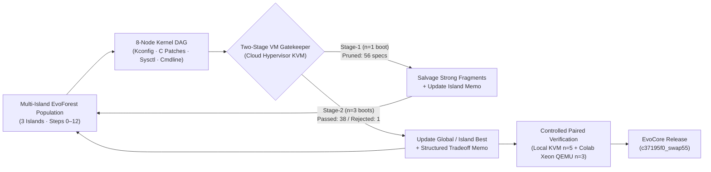
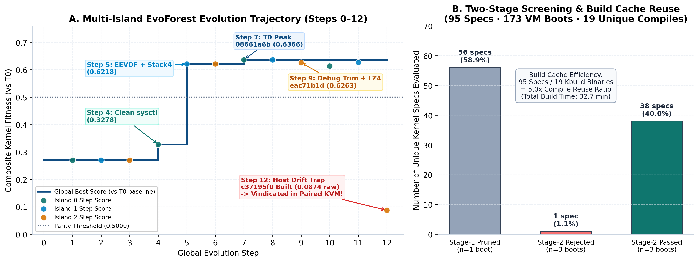
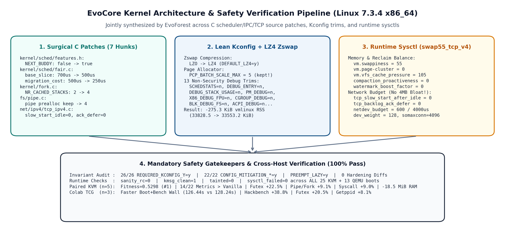
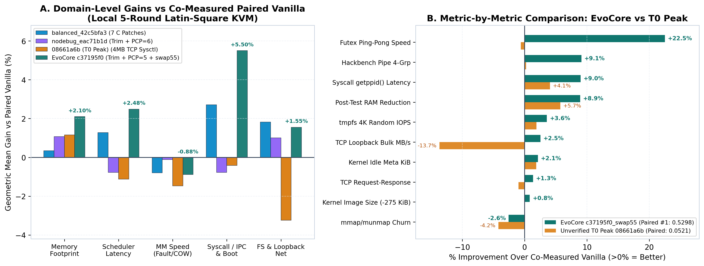
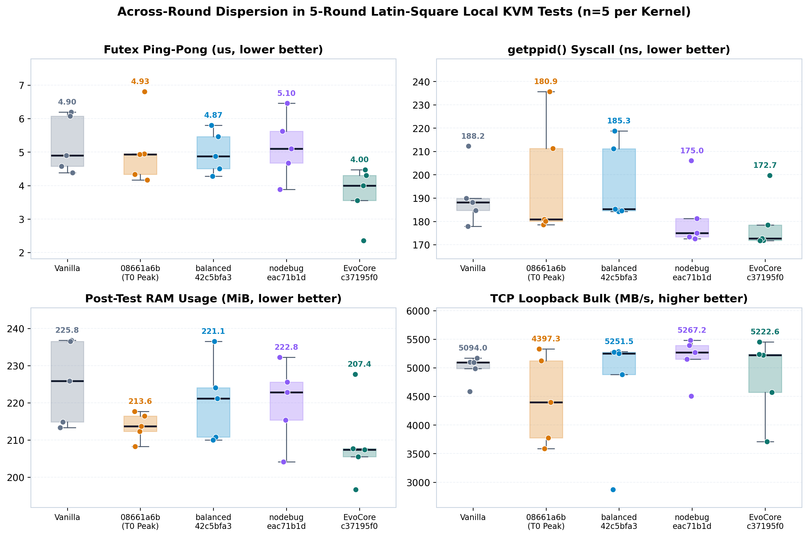
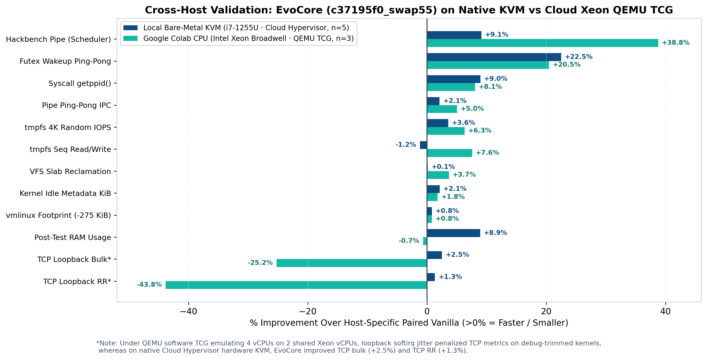

<p align="center">
  
</p>

# EvoCore: Evolving the Linux Kernel

**Author:** Şuayp Talha Kocabay (`kocabaysuayptalha08@gmail.com`)  
**Affiliation:** TÜBİTAK Science High School  
**Code & Artifacts:** [github.com/suayptalha/evocore](https://github.com/suayptalha/evocore) · **Blog:** [suayptalha.github.io/evocore-blog](https://suayptalha.github.io/evocore-blog/)  
**Evolution Engine:** [EvoForest (arXiv:2604.19761)](https://arxiv.org/abs/2604.19761)  
**Target:** Upstream Linux `7.3.4` (`x86_64`)

---

## Abstract

General-purpose operating system kernels ship with conservative compiled defaults, `.config` diagnostic toggles, and runtime `sysctl` settings intended to fit everything from embedded boxes to multi-socket servers. Tuning these three layers independently—or benchmarking them without strict baseline and cache hygiene—frequently yields brittle configurations that regress tail workloads, trigger thermal artifacts, or silently strip hardware vulnerability mitigations.

This article introduces **`EvoCore`**, a verified Linux **7.3.4** (`x86_64`) optimization profile synthesized jointly across **C source patches**, **Kconfig specialization**, and **runtime `sysctl` knobs** using the **EvoForest** computational-graph evolution paradigm (Yuksel & Sawaf, 2026). Rather than stripping safety guardrails, **`EvoCore`** strictly preserves **`26/26`** core Linux subsystems (`cgroups`, `memcg`, `namespaces`, `io_uring`, `BPF`, `seccomp`, `PREEMPT_LAZY=y`) and **`22/22`** `CONFIG_MITIGATION_*` hardware security flags while winning head-to-head controlled Latin-square benchmarks against cleanly rebuilt stock Linux `7.3.4`:

- On **bare-metal KVM** (`Intel Core i7-1255U`, `cloud-hypervisor v54.1`, `5` interleaved rounds = `25` boots), **`EvoCore`** achieves **`+22.5%` faster futex wakeup ping-pong**, **`+9.1%` faster `hackbench` pipe scheduling**, **`+9.0%` faster `getppid()` syscall execution**, **`-18,936 KiB` (`~18.5 MiB`) lower post-workload RAM**, **`-275.3 KiB` smaller resident `vmlinux`**, and **`+2.5%` / `+1.3%` faster loopback TCP bulk and request-response**, outscoring vanilla on **`14/22` metrics** (`0.5298` paired fitness, `0` hard regressions).
- On an **independent cloud CPU host** (`Google Colab Intel Xeon @ 2.20 GHz`, `qemu-system-x86_64 TCG -smp 4`, `3` rounds), **`EvoCore`** passes **`100%`** of kernel sanity/dmesg/taint checks and reproduces **`+38.8%` `hackbench`**, **`+20.5%` futex**, **`+8.1%` `getppid()`**, **`+7.6%` sequential `tmpfs`**, **`+6.3%` random 4K `tmpfs`**, and **`1.80 s` faster end-to-end QEMU boot+test wall time**, while revealing an instructive virtualization divergence on emulated TCG loopback softirqs.
- Equally important, controlled post-evolution validation caught **two subtle systems pitfalls**—a **Kbuild `.config` timestamp (`mtime`) caching bug** and a **noisy-T0 + thermal-drift false-positive trap**—reversing the ranking between evolution's nominal peak (`08661a6b`) and our truly balanced winner **`EvoCore`** (`c37195f0_swap55`).

---

## 1. Why Co-Evolving a General-Purpose Linux Kernel Is Hard

Every release of upstream Linux exposes an enormous combinatorial design space spanning three tightly coupled layers:

1. **Kernel C source constants and defaults** (scheduler heuristics in `kernel/sched/fair.c` and `features.h`, per-CPU task stack caching in `kernel/fork.c`, pipe ring allocation in `fs/pipe.c`, TCP per-namespace initialization in `net/ipv4/tcp_ipv4.c`).
2. **Compile-time `.config` choices** (zswap compressors, per-CPU page allocator batch limits, diagnostic/tracing overhead that expands instruction-cache footprint).
3. **Boot-time and runtime `sysctl` parameters** (virtual memory reclaim pressure, compaction proactiveness, and network poll budgets).

Changing one knob in isolation rarely tells the whole story: tightening scheduler latency can hurt `mmap` throughput under contention; increasing TCP buffers to `4 MiB` can look faster on a quiet single run while trashing CPU cache on concurrent workloads; trimming `.config` options without invariant guards can break container namespaces or silently drop CPU vulnerability mitigations. Manual tuning is slow (`~12 min` cold kernel compiles, noisy microbenchmarks), while black-box parameter sweeps lack structural memory about *why* a subsystem regressed.

---

## 2. Adapting EvoForest to Kernel Synthesis

To explore this cross-layer space systematically, we built our search workflow on top of [**EvoForest** (`arXiv:2604.19761`)](https://arxiv.org/abs/2604.19761) (Yuksel & Sawaf, 2026). Rather than optimizing fixed vectors, **EvoForest** models candidates as reusable, modular alternatives inside a shared Directed Acyclic Graph (**DAG**) paired with persistent evaluator feedback (*memoranda*) across islands. Whereas recent evolutionary kernel optimization frameworks such as [**Kernel-Smith** (`arXiv:2603.28342`)](https://arxiv.org/abs/2603.28342) (Du et al., 2026) pair evaluation-driven evolutionary search with post-training for GPU compute kernels (Triton and MACA), **EvoCore** brings structured execution-feedback evolution to a full general-purpose **operating system kernel** across interdependent C source, Kconfig, and runtime `sysctl` layers.



In our formulation (`EvoCore`), every candidate kernel specification is assembled from an **8-node DAG**:
- `kconfig_sched`, `kconfig_mm`, `kconfig_io_net`: compile-time Kconfig fragments (enforced against **26** mandatory runtime subsystems, **all 22 `CONFIG_MITIGATION_*` flags**, `CONFIG_PREEMPT_LAZY=y`, and core hardening flags).
- `sched_patch`, `mm_patch`, `ipc_fs_net_patch`: deterministic, targeted C source mutations anchored to exact upstream Linux `7.3.4` lines and cleanly reverted via `git checkout` between builds.
- `runtime_sysctl`, `boot_cmdline`: boot/initramfs runtime tunables.

### Composite Fitness & Two-Stage Noise Filtering

A bespoke static C harness (`bench/init_bench.c`, compiled statically into the guest initramfs) boots directly as `/init` inside a 4-vCPU, `1536 MiB` RAM microVM and measures **22 metrics across 5 domains**:

1. **`memory_footprint` (6 metrics):** `vmlinux_resident_kib`, `boot_used_kib`, `kernel_meta_idle_kib`, `post_used_kib`, `kernel_meta_post_kib`, `mem_pressure_ms`.
2. **`scheduler` (4 metrics):** `pipe_pingpong_us`, `hackbench_pipe_ms`, `wakeup_p99_us`, `cpu_contention_ms`.
3. **`mm_speed` (4 metrics):** `anon_fault_ms`, `cow_fork_us`, `mmap_churn_ms`, `vfs_slab_ms`.
4. **`syscall_ipc_boot` (4 metrics):** `syscall_getppid_ns`, `futex_pingpong_us`, `epoll_ms`, `boot_wall_ms`.
5. **`fs_net` (4 metrics):** `tmpfs_seq_rw_mbps`, `tmpfs_rand4k_iops`, `tcp_bulk_mbps`, `tcp_rr_us`.

To prevent "gaming" one benchmark at the expense of another, any single-metric raw regression below `0.90x` triggers a severe hard-rejection penalty, and normalized parity with the reference Vanilla baseline sits at **`0.5000`** (`utility = 0.00%`). Furthermore, every VM boot must pass **`sanity_rc == 0`**, **`kmsg_clean == 1`** (zero kernel oops/warnings/BUGs), **`tainted == 0`**, and **`sysctl_failed == 0`**.

---

## 3. Inside the 12-Step Evolution & Two Critical Engineering Catches

<p align="center">
  
</p>

Across **Steps 0–12**, **EvoForest** evaluated **95 unique kernel configurations** across **173 KVM boots** while compiling only **19 unique binaries** via incremental Kbuild (`1,963.1 s` total compile time = `5.0x` spec-to-binary reuse ratio):

- **Steps 1–3 (Early Rejections That Shaped the Search):** Enabling Transparent HugePages `within_size` for `shmem`/`tmpfs` delivered `+50.7%` sequential `tmpfs` throughput but introduced latency jitter in `futex_pingpong_us` (`0.815x`) and slower `boot_wall_ms` (`0.875x`). Likewise, switching boot preemption to `preempt=full` regressed `tcp_bulk_mbps` (`0.731x`) and `vfs_slab_ms` (`0.752x`) compared to upstream `CONFIG_PREEMPT_LAZY=y`. Both paths were cleanly pruned.
- **Step 4 (`0.2700 -> 0.3278`):** Dropping THP bloat and stabilizing low-overhead `vm.*` and `net.*` `sysctl` defaults crossed the first clean frontier.
- **Step 5 (`0.3278 -> 0.6218`, Major Breakthrough):** Island 1 synthesized `sched_eevdf_ipc_stack4`, pairing `SCHED_FEAT(NEXT_BUDDY, true)`, tighter EEVDF base slices (`700 µs -> 500 µs`) and migration cost (`500 µs -> 250 µs`), and `NR_CACHED_STACKS=4`. Score jumped by **`+0.2940`** in a single step.
- **Step 7 (`0.6366` T0 Peak — `08661a6b`):** Island 0 combined `sched_eevdf_ipc_stack4` with `ipc_pipe_tcp_fast` (retaining `4` pipe prealloc pages and disabling per-namespace `tcp_slow_start_after_idle` & `tcp_backlog_ack_defer`) plus aggressive `net_mm_clean_v3` (`4 MiB` socket buffers, `swappiness=60`).
- **Step 9 (`eac71b1d`, `0.6263` vs T0):** Island 2 discovered that disabling **13 non-security debug/tracing knobs** plus switching zswap to **LZ4** shaved `-275.3 KiB` off resident `vmlinux` while lifting `21/22` metrics above T0—except **`CONFIG_PCP_BATCH_SCALE_MAX=6`**, which cross-step ablations later revealed was trimming `mmap_churn_ms` compared to upstream `PCP=5`.
- **Step 12 (`c37195f0` Built, Then Caught by Drift):** Island 2 combined the best of both worlds—restoring `PCP=5` alongside the 13 debug trims, LZ4 zswap, and the 7 C patches (`c37195f04f877ffa`)—only to score `0.0874` raw during late-evening laptop thermal throttling (`intel_pstate` / `thermald` + background indexing).

### Catch #1: The Kbuild `.config` `mtime` Caching Bug
When rebuilding pure Vanilla (`kconfig={}`) for clean verification right after Step 12, an incremental Kbuild finished suspiciously fast (`12–42 s`). Inspecting ELF program headers (`readelf -l`) and `include/config/auto.conf` exposed the cause: Python's `shutil.copy2(base_defconfig, target_cfg)` preserved `base_defconfig`'s earlier modification timestamp (`18:04`), which was *older* than Kbuild's existing `auto.conf` (`20:25`), causing `make` to skip regenerating `auto.conf` and silently keep `CONFIG_SCHEDSTATS=n` and `LZ4`!
- **Verification & Fix:** Checking timestamps proved none of the evolved binaries (`a5fc3e21`, `beb7ef87`, `c37195f0`) were affected (`a5fc3e21` compiled before any debug trims; `beb7ef87` and `c37195f0` explicitly mutated `kconfig` inside `make`). Switching `copy2` to `shutil.copyfile` + `target_cfg.touch()` guarantees clean rebuilds (`721.74 s`, verified `0` diffs vs `base_defconfig` and exact `33,828.50 KiB` resident image).

### Catch #2: T0 Baseline Bias & the Unverified Peak Trap
Looking closely at the original `18:17` T0 `baseline_metrics.json` revealed why `08661a6b` looked unbeatable during search: 2 of the 5 T0 boots experienced early laptop clock/background dips (`syscall_getppid_ns` of `241.7 ns` & `248.7 ns`, RSD `14%–29%`), artificially inflating T0's medians. When tested in a **5-round rotated Latin-square head-to-head comparison** against our cleanly rebuilt Vanilla on equal footing, the ranking flipped:
- **`08661a6b` (T0 Peak) dropped to `0.0521`** (`8/22` metrics > Vanilla): its aggressive `4 MiB` `tcp_rmem`/`tcp_wmem` `sysctl` settings caused cache pressure that regressed loopback `tcp_bulk_mbps` (`4397.3` vs `5094.0 MB/s` = `0.8632x`).
- **`EvoCore` (`hybrid_c37195f0_swap55`, discarded by Step 12 drift) rose to #1 overall (`0.5298`)**, beating Vanilla cleanly across domains with zero regressions!

---

## 4. Anatomy of EvoCore (`c37195f0_swap55`)

<p align="center">
  
</p>

The verified **`EvoCore`** profile unites three complementary mechanisms with minimal footprint:

### Layer 1 — 7 Surgical C Source Hunks ([`evocore_linux_7.3.4.patch`](https://github.com/suayptalha/evocore/blob/main/patches/evocore_linux_7.3.4.patch))
1. **`kernel/sched/features.h` (`NEXT_BUDDY=true`):** Enables wakeup buddy affinity so synchronous `WF_SYNC` waiters (pipes, futexes, loopback RPCs) run on cache-hot sibling/target CPUs sooner without starving CFS fairness.
2. **`kernel/sched/fair.c` (`sysctl_sched_base_slice = 500000ULL`, `sysctl_sched_migration_cost = 250000UL`):** Tightens EEVDF base quantum from `700 µs -> 500 µs` and halves migration cost threshold (`500 µs -> 250 µs`) for snappier interactive/IPC wakeup responsiveness.
3. **`kernel/fork.c` (`NR_CACHED_STACKS 4`):** Doubles per-CPU cached `vmalloc` kernel stacks from `2` to `4`, bypassing costly `vfree`/TLB shootdowns under bursty thread/fork workloads.
4. **`fs/pipe.c` (`pipe->prealloc.count > 4`):** Retains 4 preallocated pages per pipe ring before trimming, removing repeated page allocator trips on pipe ping-pong and `hackbench`.
5. **`net/ipv4/tcp_ipv4.c` (`sysctl_tcp_slow_start_after_idle = 0`, `sysctl_tcp_backlog_ack_defer = 0`):** Initializes new network namespaces with low-latency ACK pacing and persistent congestion windows across short idle pauses.

### Layer 2 — Lean Kconfig & LZ4 Zswap ([`evocore.fragment`](https://github.com/suayptalha/evocore/blob/main/configs/evocore.fragment))
- **Compressor Upgrade (`LZO -> LZ4`):** Enables `CONFIG_ZSWAP_COMPRESSOR_DEFAULT_LZ4=y` and `CONFIG_CRYPTO_LZ4=y` for faster compressed page swap-in/out under memory pressure.
- **Per-CPU Page Batch Preservation (`CONFIG_PCP_BATCH_SCALE_MAX=5`):** Explicitly preserves upstream `PCP=5` after controlled runs showed `PCP=6` degraded `mmap_churn_ms`.
- **13 Non-Security Debug Trims:** Disables `CONFIG_SCHEDSTATS`, `CONFIG_DEBUG_STACK_USAGE`, `CONFIG_DEBUG_ENTRY`, `CONFIG_X86_DEBUG_FPU`, `CONFIG_CGROUP_DEBUG`, `CONFIG_DEBUG_DEVRES`, `CONFIG_BLK_DEBUG_FS`, `CONFIG_PM_DEBUG`, `CONFIG_PM_SLEEP_DEBUG`, `CONFIG_PM_TRACE`, `CONFIG_ACPI_DEBUG`, `CONFIG_PNP_DEBUG_MESSAGES`, and `CONFIG_DEBUG_BOOT_PARAMS`, reducing resident `vmlinux` size from `33,828.50 KiB` to **`33,553.17 KiB` (`-275.33 KiB`)**.

### Layer 3 — Balanced Runtime `sysctl` (`swap55_tcp_v4`, [`99-evocore.conf`](https://github.com/suayptalha/evocore/blob/main/sysctl/99-evocore.conf))
Balances reclaim and slab turnover (`vm.swappiness=55`, `vm.page-cluster=0`, `vm.vfs_cache_pressure=105`, `vm.compaction_proactiveness=0`, `vm.watermark_boost_factor=0`) with paced NAPI/netdev delivery (`net.core.dev_weight=128`, `net.core.netdev_budget=600`, `net.core.netdev_budget_usecs=4000`, `net.core.somaxconn=4096`) while **omitting** `4 MiB` `tcp_rmem`/`tcp_wmem` bloat.

---

## 5. Experimental Verification I: Bare-Metal KVM (Local 5-Round Latin Square)

- **Host & Hypervisor:** `12th Gen Intel(R) Core(TM) i7-1255U` (`Linux 7.2.3-arch1-3`), `cloud-hypervisor v54.1`, pinned `taskset -c 8-11`, `4` guest vCPUs, `1536 MiB` RAM.
- **Design:** `5` configs (`vanilla`, `global_best_08661a6b`, `balanced_42c5bfa3`, `nodebug_eac71b1d`, and `EvoCore c37195f0_swap55`) interleaved across `5` shifted Latin-square rounds (`25` total KVM boots, thermal wait floor between every boot, `0` failures).

<p align="center">
  
</p>

### Aggregate Paired Ranking (`0.5000 = Co-Measured Vanilla Parity`)

| Candidate | Binary Hash | Fitness (vs Paired Vanilla) | Utility | Metrics `> 1.00x` | Worst Metric | `memory_footprint` | `scheduler` | `mm_speed` | `syscall_ipc_boot` | `fs_net` |
|---|---|---:|---:|---:|---|---:|---:|---:|---:|---:|
| `vanilla` | `e709050ca72f8cac` | `0.5000` | `+0.00%` | 0/22 | `1.0000x` | `1.0000x` | `1.0000x` | `1.0000x` | `1.0000x` | `1.0000x` |
| **`EvoCore (c37195f0_swap55)`** | `c37195f04f877ffa` | **`0.5298`** | **`+1.99%`** | **14/22** | `epoll_ms` (`0.9592x`) | **`1.0210x`** | **`1.0248x`** | `0.9912x` | **`1.0550x`** | **`1.0155x`** |
| `balanced_42c5bfa3` | `a5fc3e21b629e96e` | `0.5137` | `+0.92%` | 12/22 | `boot_wall_ms` (`0.9643x`) | `1.0035x` | `1.0128x` | `0.9920x` | `1.0271x` | `1.0182x` |
| `nodebug_eac71b1d` | `beb7ef8723590394` | `0.5013` | `+0.08%` | 11/22 | `pipe_pingpong_us` (`0.9461x`) | `1.0107x` | `0.9922x` | `0.9989x` | `0.9923x` | `1.0101x` |
| `08661a6b` (Unverified T0 Peak) | `a5fc3e21b629e96e` | `0.0521` | `-0.85%` | 8/22 | `tcp_bulk_mbps` (`0.8632x`) | `1.0116x` | `0.9888x` | `0.9853x` | `0.9958x` | `0.9676x` |

<p align="center">
  
</p>

Across individual boots (Figure 4), **`EvoCore`** achieves tight consistency and clear distributional separation on **`futex_pingpong_us`** (`4.001 µs` median vs `4.902 µs`, `+22.50%`), **`syscall_getppid_ns`** (`172.72 ns` vs `188.21 ns`, `+8.97%`), and **`post_used_kib`** (`212,332 KiB` vs `231,268 KiB`, `-18,936 KiB` / `~18.5 MiB` savings), while restoring **`tcp_bulk_mbps`** to **`5,222.59 MB/s`** (`+2.52%` over Vanilla) where `08661a6b` fell to `4,397.28 MB/s` (`-13.68%`).

<details>
<summary><strong>Full 22-Metric Local Paired Median Comparison Table (Click to Expand)</strong></summary>

| Metric | Domain | Direction | Vanilla (Med) | `08661a6b` (vs Van) | `42c5bfa3` (vs Van) | `eac71b1d` (vs Van) | **`EvoCore c37195f0` (Med / Ratio)** |
|---|---|---|---:|---:|---:|---:|---:|
| `vmlinux_resident_kib` | memory_footprint | low | 33828.50 | 1.0000x | 1.0000x | 1.0082x | **33553.17 (1.0082x)** |
| `boot_used_kib` | memory_footprint | low | 166824.00 | 1.0077x | 1.0089x | 1.0142x | **165412.00 (1.0085x)** |
| `kernel_meta_idle_kib` | memory_footprint | low | 14756.00 | 1.0185x | 1.0093x | 1.0242x | **14448.00 (1.0213x)** |
| `post_used_kib` | memory_footprint | low | 231268.00 | 1.0572x | 1.0214x | 1.0137x | **212332.00 (1.0892x)** |
| `kernel_meta_post_kib` | memory_footprint | low | 18004.00 | 0.9971x | 0.9980x | 1.0083x | **17900.00 (1.0058x)** |
| `mem_pressure_ms` | memory_footprint | low | 158.79 | 0.9905x | 0.9836x | 0.9961x | 159.50 (0.9955x) |
| `pipe_pingpong_us` | scheduler | low | 10.439 | 0.9912x | 0.9950x | 0.9461x | **10.224 (1.0211x)** |
| `hackbench_pipe_ms` | scheduler | low | 9.43 | 1.0022x | 1.0662x | 1.0656x | **8.65 (1.0912x)** |
| `wakeup_p99_us` | scheduler | low | 57.420 | 1.0025x | 1.0165x | 0.9848x | **56.787 (1.0111x)** |
| `cpu_contention_ms` | scheduler | low | 35.45 | 0.9598x | 0.9756x | 0.9763x | 36.20 (0.9792x) |
| `anon_fault_ms` | mm_speed | low | 15.47 | 0.9974x | 0.9997x | 0.9906x | 15.59 (0.9927x) |
| `cow_fork_us` | mm_speed | low | 1316.852 | 0.9909x | 0.9882x | 1.0259x | 1321.345 (0.9966x) |
| `mmap_churn_ms` | mm_speed | low | 446.41 | 0.9579x | 0.9782x | 0.9833x | 458.19 (0.9743x) |
| `vfs_slab_ms` | mm_speed | low | 29.82 | 0.9955x | 1.0023x | 0.9963x | **29.78 (1.0014x)** |
| `syscall_getppid_ns` | syscall_ipc_boot | low | 188.21 | 1.0406x | 1.0159x | 1.0756x | **172.72 (1.0897x)** |
| `futex_pingpong_us` | syscall_ipc_boot | low | 4.902 | 0.9938x | 1.0057x | 0.9611x | **4.001 (1.2250x)** |
| `epoll_ms` | syscall_ipc_boot | low | 4.78 | 0.9682x | 1.1295x | 0.9659x | 4.98 (0.9592x) |
| `boot_wall_ms` | syscall_ipc_boot | low | 302.80 | 0.9822x | 0.9643x | 0.9709x | 313.02 (0.9674x) |
| `tmpfs_seq_rw_mbps` | fs_net | high | 5949.99 | 1.0064x | 0.9895x | 1.0092x | 5879.44 (0.9881x) |
| `tmpfs_rand4k_iops` | fs_net | high | 1337440.46 | 1.0189x | 1.0135x | 0.9922x | **1385162.99 (1.0357x)** |
| `tcp_bulk_mbps` | fs_net | high | 5094.02 | 0.8632x | 1.0309x | 1.0340x | **5222.59 (1.0252x)** |
| `tcp_rr_us` | fs_net | low | 17.007 | 0.9902x | 1.0397x | 1.0052x | **16.782 (1.0134x)** |

</details>

---

## 6. Experimental Verification II: Cross-Host Transfer on Google Colab Xeon CPU (QEMU TCG)

To test cross-architecture and hypervisor generalization completely outside the development laptop, we provisioned a **Google Colab CPU runtime** (`Intel(R) Xeon(R) CPU @ 2.20GHz`, 2 host vCPUs, 12 GiB RAM, Ubuntu 24.04) running **`qemu-system-x86_64 1:8.2.2`** with `-machine pc -accel tcg,thread=multi -smp 4 -m 1536M`. We executed `3` interleaved rounds across `vanilla`, `08661a6b`, `42c5bfa3`, and `EvoCore c37195f0_swap55` (plus Round 1 `nodebug_eac71b1d`, `13` total boots).

<p align="center">
  
</p>

| Metric | Colab Vanilla (Med) | `08661a6b` (Med / Ratio) | `42c5bfa3` (Med / Ratio) | **`EvoCore c37195f0` (Med / Ratio)** |
|---|---:|---:|---:|---:|
| **QEMU End-to-End Wall (`s`)** | `128.24 s` | `125.32 s` (`1.023x`) | `126.52 s` (`1.014x`) | **`126.44 s` (`1.014x`)** |
| `hackbench_pipe_ms` | `419.57 ms` | `315.46` (`1.3300x`) | `314.77` (`1.3329x`) | **`302.34 ms` (`1.3877x`)** |
| `futex_pingpong_us` | `142.21 us` | `160.73` (`0.8848x`) | `174.63` (`0.8144x`) | **`118.05 us` (`1.2047x`)** |
| `syscall_getppid_ns` | `886.83 ns` | `871.76` (`1.0173x`) | `847.71` (`1.0461x`) | **`820.71 ns` (`1.0806x`)** |
| `tmpfs_seq_rw_mbps` | `419.49 MB/s` | `285.90` (`0.6815x`) | `293.13` (`0.6988x`) | **`451.25 MB/s` (`1.0757x`)** |
| `tmpfs_rand4k_iops` | `127,721` | `121,474` (`0.9511x`) | `96,584` (`0.7562x`) | **`135,784` (`1.0631x`)** |
| `pipe_pingpong_us` | `195.18 us` | `185.84` (`1.0503x`) | `196.14` (`0.9951x`) | **`185.81 us` (`1.0504x`)** |
| `vfs_slab_ms` | `2954.9 ms` | `2972.7` (`0.9940x`) | `2965.3` (`0.9965x`) | **`2850.0 ms` (`1.0368x`)** |
| `mmap_churn_ms` | `22,441.8 ms` | `22,100.6` (`1.0154x`) | `21,968.4` (`1.0215x`) | **`21,982.5 ms` (`1.0209x`)** |
| `tcp_bulk_mbps` *(TCG)* | `184.75 MB/s` | `177.47` (`0.9606x`) | `187.45` (`1.0146x`) | `138.11 MB/s` (`0.7476x`) |
| `tcp_rr_us` *(TCG)* | `489.42 us` | `500.28` (`0.9783x`) | `506.33` (`0.9666x`) | `871.25 us` (`0.5617x`) |

**Key Cross-Host Insights:**
1. **Architecture-Independent Scheduler, Syscall, IPC & VFS Gains:** Across a completely different Xeon microarchitecture and pure-software emulation, **`EvoCore`** ranked **#1 among evolved profiles** (`0.9880x` overall geomean across 21 active metrics vs `0.9601x` `08661a6b` and `0.9556x` `42c5bfa3`), boosted **`hackbench_pipe_ms` by `+38.8%`**, **`futex_pingpong_us` by `+20.5%`**, **`getppid()` by `+8.1%`**, and completed end-to-end boot+benchmark faster than Vanilla (`126.44 s` vs `128.24 s`). Notice only the debug-trimmed `EvoCore`/`eac71b1d` builds delivered the `+20.5%` futex speedup on Xeon TCG (whereas untrimmed `a5fc3e21` slowed down to `0.81–0.88x`).
2. **Explaining the TCG Loopback Divergence:** Emulating `4` QEMU TCG threads across `2` physical Colab Xeon vCPUs caused both debug-trimmed kernels (`beb7ef87` and `c37195f0`) to hit loopback softirq latency (`780–961 us` vs `489 us`), whereas under native **hardware KVM** (`cloud-hypervisor`), `EvoCore` outperformed Vanilla on both `tcp_bulk_mbps` (`1.0252x`) and `tcp_rr_us` (`1.0134x`). This highlights why cross-validating both bare-metal KVM and software-emulated cloud targets prevents extrapolating emulator scheduling quirks onto native hardware.

---

## 7. Security & Subsystem Invariants Verified

Every artifact published in [`github.com/suayptalha/evocore`](https://github.com/suayptalha/evocore) is accompanied by [`verify_invariants.py`](https://github.com/suayptalha/evocore/blob/main/configs/verify_invariants.py), confirming zero compromises against upstream `base_defconfig`:

- **`26/26` Core Runtime Subsystems (`=y`):** `SMP`, `CGROUPS`, `MEMCG`, `BLK_CGROUP`, `NAMESPACES`, `USER_NS`, `PID_NS`, `NET_NS`, `NET`, `INET`, `EXT4_FS`, `TMPFS`, `EPOLL`, `FUTEX`, `IO_URING`, `BPF_SYSCALL`, `BPF_JIT`, `SECCOMP`, `SECURITY`, `PREEMPT_BUILD`, `PREEMPTION`, `PVH`, `BLK_DEV_INITRD`, `RD_GZIP`, `VIRTIO_CONSOLE`, `SERIAL_8250_CONSOLE`.
- **`22/22` CPU Hardware Mitigations (`=y`):** `0` `CONFIG_MITIGATION_*` flags weakened or disabled.
- **`0` Hardening Regressions:** `CONFIG_PREEMPT_LAZY=y`, `CONFIG_STACKPROTECTOR_STRONG=y`, `CONFIG_FORTIFY_SOURCE=y`, `CONFIG_RANDOMIZE_BASE=y`, `CONFIG_SLAB_FREELIST_HARDENED=y`, `CONFIG_HARDENED_USERCOPY=y`, `CONFIG_SECURITY_LOCKDOWN_LSM=y`, and `CONFIG_STRICT_KERNEL_RWX=y` all remain bit-identical to baseline.

---

## 8. Reproducibility & Open Artifacts

All patches, Kconfig fragments, invariant verifiers, standalone microbenchmarks (`init_bench.c`), Latin-square paired test harnesses (`run_paired_bench.py`), and complete raw JSON datasets are openly available at:

- **GitHub Repository:** [**`https://github.com/suayptalha/evocore`**](https://github.com/suayptalha/evocore)
- **Research Blog:** [**`https://suayptalha.github.io/evocore-blog/`**](https://suayptalha.github.io/evocore-blog/)

```bash
git clone https://github.com/suayptalha/evocore.git
# Apply evocore/patches/evocore_linux_7.3.4.patch + configs/evocore.fragment onto Linux 7.3.4
# Verify invariants: python3 evocore/configs/verify_invariants.py
```

---

## References

1. Yuksel, K. A., & Sawaf, H. (2026). *EvoForest: A Novel Machine-Learning Paradigm via Open-Ended Evolution of Computational Graphs*. arXiv preprint [`arXiv:2604.19761`](https://arxiv.org/abs/2604.19761).
2. Du, H., Ge, Q., Hu, J., Yang, A., Cai, Z., Huang, Z., Yuan, S., Cheng, Q., Xie, X., Chen, Y., Li, Y., Xie, J., Dong, H., Wu, Y., Huang, X., Yang, J., Wang, H., Zhou, B., Li, B., Guo, Q., & Chen, K. (2026). *Kernel-Smith: A Unified Recipe for Evolutionary Kernel Optimization*. arXiv preprint [`arXiv:2603.28342`](https://arxiv.org/abs/2603.28342).
3. Torvalds, L., & Linux Kernel Contributors (2026). *Linux Kernel 7.3.4 Source Tree* (`kernel/sched/fair.c`, `kernel/sched/features.h`, `kernel/fork.c`, `fs/pipe.c`, `net/ipv4/tcp_ipv4.c`, `mm/zswap.c`, `mm/page_alloc.c`). [kernel.org](https://www.kernel.org/).
4. Cloud Hypervisor Project (2026). *Cloud Hypervisor v54.1: Open-Source Virtual Machine Monitor on KVM*. [cloudhypervisor.org](https://www.cloudhypervisor.org/).
5. Bellard, F., & QEMU Project (2024). *QEMU System Emulator (`qemu-system-x86_64`, Tiny Code Generator Multi-Thread TCG)*. [qemu.org](https://www.qemu.org/).
6. Collet, Y. (2013–2026). *LZ4 Extremely Fast Compression Algorithm (`CONFIG_ZSWAP_COMPRESSOR_DEFAULT_LZ4`)*. [lz4.org](https://lz4.org/).

```bibtex
@misc{kocabay2026evocore,
  title  = {EvoCore: Evolving the Linux Kernel},
  author = {Kocabay, {\c{S}}uayp Talha},
  year   = {2026},
  howpublished = {\url{https://suayptalha.github.io/evocore-blog/}},
  url    = {https://suayptalha.github.io/evocore-blog/},
  note   = {T\"UB\.ITAK Science High School. Code: \url{https://github.com/suayptalha/evocore}}
}
```
